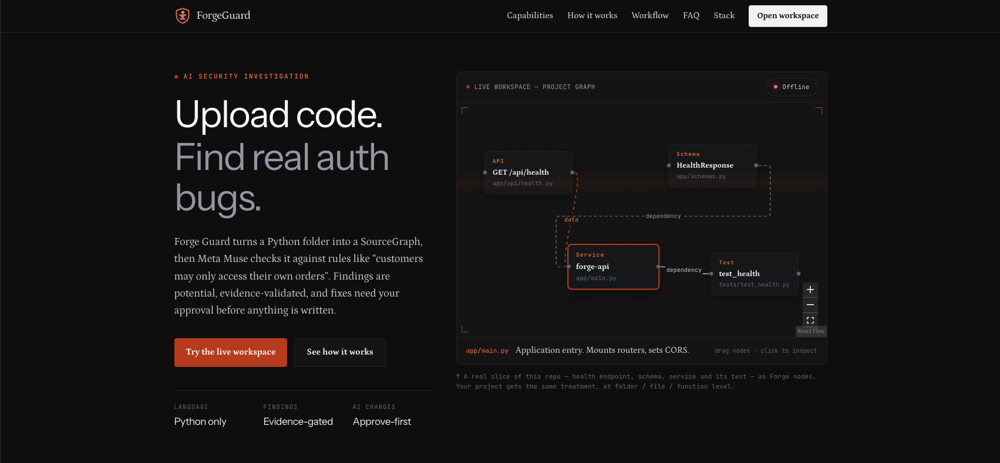

<h1 align="center">Forge Guard</h1>

<p align="center">
  <a href="https://youtu.be/HGdAP40hpVs">
    
  </a>
</p>

<p align="center">
  <a href="https://youtu.be/HGdAP40hpVs">
    
  </a>
</p>

Forge Guard is an AI-powered software engineering and security analysis environment.
It inspects existing Python projects, builds a read-only **SourceGraph** from their
structure, and investigates user-defined security or business rules with a
Meta Muse-powered agent. Findings are evidence-gated: the backend validates
reported source locations before returning them. Fix proposals require human
approval before application; apply and rollback are supported.

## Problem statement

Modern applications often fail in business logic and authorization paths that are
hard to see from framework-level scanning alone. Forge Guard connects project
structure, source evidence, and AI-assisted investigation so that potential
violations can be traced to real files, symbols, and graph nodes.

## Features

- Register an existing Python project inside a configured workspace root (sample or folder upload).
- Discover and index Python source files via AST (code is never executed).
- Resolve structural symbols and relationships.
- Generate a read-only SourceGraph with drill-down levels (project → folder → file).
- Investigate user-provided security rules with Meta Muse.
- Validate model-proposed source locations against actual source.
- Map valid findings to SourceGraph nodes.
- Review, apply, roll back, and verify controlled corrections.
- Download fixes as a `.patch` (`git apply`) or the project copy as a `.zip`.
- Deterministic backend tests for investigation and evidence validation.

## Core workflow

1. Upload a Python project folder (or open the sample — each visitor gets their own copy).
2. Index its source and generate its SourceGraph (Map).
3. Provide a security or business rule and run an investigation, watching live agent activity.
   - Sample project: 3 demo preset rules (default: order ownership).
   - Uploaded projects: rules generated from routes and resource IDs, or a custom rule you write.
4. Understand findings and validated source evidence with SourceGraph node matches.
5. Review the proposed fix side-by-side on the Changes tab; approve or reject it.
6. Apply the fix, or roll it back.
7. Re-run the investigation to verify.
8. Download your fixes as a `.patch` or the project copy as a `.zip`.

## Architecture

Forge Guard is a modular FastAPI monolith. The frontend renders backend-provided
data and does not infer source facts.

| Component | Responsibility |
| --- | --- |
| `WorkspaceService` | Discover and safely read project files |
| `PythonIndexer` | Extract structural AST facts |
| `SymbolResolver` | Resolve structural relationships with explicit statuses |
| `SourceGraphBuilder` | Create a read-only SourceGraph |
| `SecurityInvestigationService` | Prepare rule context and validate findings |
| `ViolationsFinderAgent` | Call Meta Muse and parse locations (LangGraph / LangChain) |
| `EvidenceValidator` | Independently validate source evidence |
| Fix proposal services | Controlled proposal, approval, apply, rollback, verify |

```text
frontend/    React, TypeScript, Vite workspace + landing
backend/     FastAPI application, schemas, services, tests
docs/        Architecture and API contract documentation
agent_loop/  Orchestration scaffold
```

## Models

| Model | Role |
| --- | --- |
| **Muse Spark** (`muse-spark-1.3`) | Default runtime model via the Meta Model API — rule investigation and fix proposals |
| **Muse Wonder** | Frontend UI and visual design |
| **Muse Code** | Coding assistance across the codebase |

Agent orchestration uses **LangChain** and **LangGraph**. Override the runtime
model with `META_MODEL_NAME` (optional preview: `muse-wonder-1.0`). Keys stay in
`backend/.env` only — never in the frontend.

## Technology stack

**Backend**

- Python 3.11+
- FastAPI, Pydantic, Uvicorn
- LangChain and LangGraph
- Meta Muse / Meta Model API
- pytest

**Frontend**

- React, TypeScript, Vite
- Tailwind CSS, React Flow, Motion
- Shiki (code highlighting)

## Setup

### Backend

```bash
cd backend
python3 -m venv .venv && source .venv/bin/activate
pip install -r requirements.txt
```

Create `backend/.env`:

```text
META_MODEL_API_KEY=<your-key>
```

Optional variables:

```text
META_MODEL_NAME=muse-spark-1.3
META_MODEL_BASE_URL=https://api.meta.ai/v1
FORGE_WORKSPACE_ROOT=<workspace-root>
FORGE_MAX_FILE_SIZE_BYTES=1048576
FORGE_CORS_ORIGINS=http://127.0.0.1:5173,http://localhost:5173
```

Run the API:

```bash
uvicorn app.main:app --reload --reload-dir app --host 127.0.0.1 --port 8000
```

`--reload-dir app` prevents uploaded projects in `workspaces/` from restarting
the server (and keeps applying a fix from wiping in-memory state).

```bash
pytest
```

### Frontend

```bash
cd frontend
npm install
npm run dev   # http://localhost:5173/workspace
```

Set `VITE_API_BASE_URL` if the backend is not at `http://127.0.0.1:8000`.

### Sample project

Use **Use sample project: Orders API** in the workspace picker
(`backend/workspaces/orders-api/`). Opening the sample copies it per visitor
(`orders-api-<id>`), so applying a fix never changes the tracked sample or
another visitor's copy. Old copies expire after `FORGE_UPLOAD_TTL_HOURS`
(default 6). Folder uploads are zipped in the browser (skipping `.git`,
`node_modules`, venvs, `.env`), extracted safely on the backend, and parsed
with `ast` — never executed.

## Limitations

- Investigation is Python-only.
- Large projects may be truncated during investigation.
- AI findings are **potential**, not confirmed vulnerabilities.
- Evidence validation checks source legitimacy, not rule truth.
- No database, Redis, or production authentication (hackathon design).
- Investigation jobs, findings, and proposals live in memory — lost on restart.
- Run exactly one backend instance / one Uvicorn worker in production for the same reason.

## Deploying (hackathon)

- **Backend (Render / Railway):** root `backend/`, `pip install -r requirements.txt`,
  start with `uvicorn app.main:app --host 0.0.0.0 --port $PORT --proxy-headers --forwarded-allow-ips='*'`.
  Set `META_MODEL_API_KEY`, `META_MODEL_BASE_URL`, `META_MODEL_NAME`, `FORGE_ENV=production`,
  `FORGE_CORS_ORIGINS`, and a persistent `FORGE_WORKSPACE_ROOT`.
- **Frontend (Vercel / Netlify):** root `frontend/`, `npm run build`, output `dist`;
  set `VITE_API_BASE_URL` at build time.

## Docs

- [`docs/architecture.md`](docs/architecture.md)
- [`docs/api-contracts.md`](docs/api-contracts.md)
- [`docs/source-graph.md`](docs/source-graph.md)
- [`docs/security-analysis.md`](docs/security-analysis.md)
